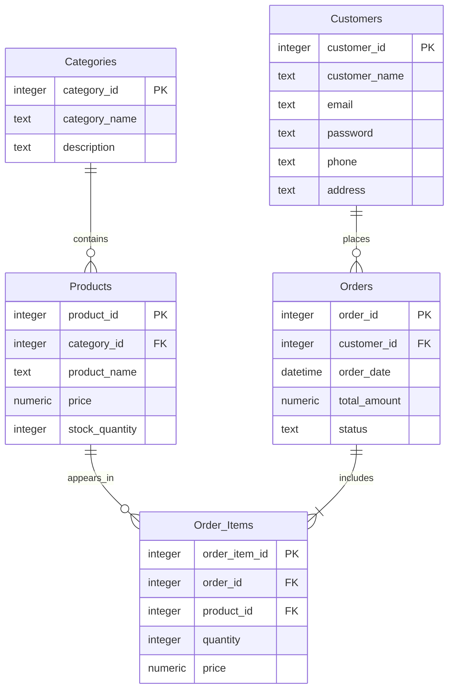

# E-commerce order database

This schema follows the supplied ERD, including the five table names, column names, primary keys, and foreign keys.

The checkout form follows the practical exercise's separate First name and Last name fields. Their trimmed values are joined into `Customers.customer_name` when submitting the order, preserving the ERD's single name column.

- `Customers.password` is empty for guest customers, so checkout requires no password. Existing account passwords remain salted scrypt hashes. Passwords and hashes are never returned by the API. Guest emails may repeat across sessions; a partial unique index preserves uniqueness for existing password-based accounts. Customers are never identified or granted order access by email alone.
- `Products.price` is the current unit price in USD. `Order_Items.price` records the unit price when purchased.
- Totals are calculated in integer cents on the server, then stored as USD amounts in the ERD's `price` and `total_amount` fields.
- An order, all its items, its customer delivery details, and stock deductions are saved in one transaction. A failed write rolls back the entire operation. A server-side stock check prevents overselling.
- The customer relation supplies customer details on an order. As in the supplied ERD, there is no separate historical address snapshot; changing the customer's details affects the details shown on their previous orders.
- Standard delivery is free, and express delivery is $10. `Orders.total_amount` includes shipping. The UI derives the shipping charge by subtracting item subtotals; no extra shipping columns are added to the supplied ERD.
- `ORD-0001` is a display format of the numeric `order_id`, not a separate database column.

The application creates `data/store.sqlite` using `schema.sql` and seeds the four exercise products from `seed.sql` on first startup. Existing customer records, orders, prices, and stock are preserved on restart. SQLite's internal `sqlite_sequence` table supports order ID allocation and is not an additional application entity.
